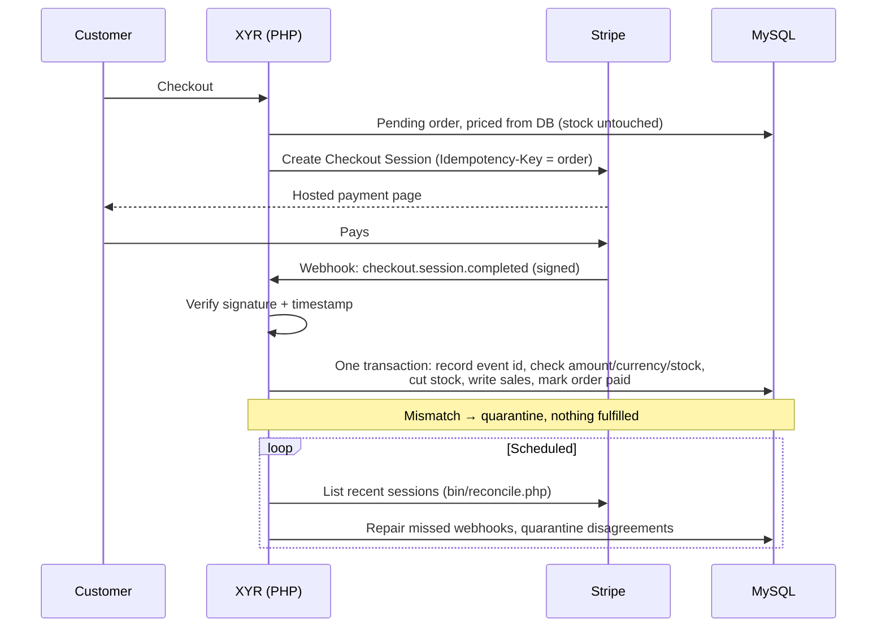

# XYR Payments Reliability Layer

[](https://github.com/ramj0002/xyr-payments-reliability/actions/workflows/tests.yml)

Stripe payments for **XYR**, a PHP/MySQL fashion e-commerce site I built with my team for NTU's IE4727 web applications course. This repository holds only the payments layer I added afterwards. The original site isn't published here.

The original checkout wrote the sale and cut stock as soon as the customer clicked "Buy", without taking any money. This layer adds real payments, and focuses on what goes wrong around them: duplicate webhooks, missed webhooks, forged requests, amounts that don't match, and stock that sells out while a customer is still paying.

## How it works



## Failure modes it handles

| What goes wrong | What happens | Test |
|---|---|---|
| Stripe delivers the same event twice (it delivers *at least once*) | Event id is recorded in the same transaction as its effects, so the repeat is a no-op | `testTheSameEventDeliveredTwiceIsAppliedOnce` |
| Two different events for one payment | Order already paid, so no double fulfilment | `testADifferentEventForAnAlreadyPaidOrderIsANoOp` |
| Forged or tampered webhook | HMAC-SHA256 signature check, constant-time comparison, returns 400 | `testRejectsATamperedPayload`, `testRejectsTheWrongSecret` |
| Captured webhook replayed later | Rejected outside a 5-minute timestamp window | `testRejectsAReplayedOldEvent` |
| Paid amount or currency differs from the order | **Quarantined**: no stock change, no sale, order flagged for review | `testQuarantinesAnAmountMismatchWithoutFulfilling` |
| Payment for an order that doesn't exist | Quarantined | `testQuarantinesAPaymentForAnUnknownOrder` |
| Stock sold out while the customer was paying | Quarantined (needs a refund decision); stock never goes negative | `testQuarantinesWhenStockSoldOutBeforePaymentLanded` |
| Database fails halfway through fulfilment | Whole transaction rolls back, endpoint returns 500, Stripe retries | `testAFailureRollsBackSoStripeCanRetry` |
| Webhook never arrives | Reconciler finds the paid session and replays it through the same handler | `testRepairsAPaymentWhoseWebhookWasMissed` |
| Order marked paid locally but Stripe has no payment | Quarantined: a local "paid" is never trusted without Stripe | `testQuarantinesALocalPaidOrderStripeCannotConfirm` |
| Network timeout while creating a session | Retried with backoff using the same idempotency key, so no duplicate sessions | `StripeHttpGateway` |
| Float rounding (`19.99 * 100 = 1998.99…`) | Money is stored as integer cents, parsed from the decimal string | `MoneyTest` |

29 tests run on every push on PHP 8.2 and 8.3 (GitHub Actions badge above).

## Design choices

- **Fulfil on the webhook, not on the redirect.** The success page can be closed, refreshed or faked. Only Stripe's signed event changes stock and sales.
- **Quarantine instead of guessing.** A payment that doesn't match is set aside with a reason (`payment_quarantine`). It isn't silently fixed or dropped, and it doesn't block other orders. Quarantined events still return 200, so Stripe doesn't retry something only a person can resolve.
- **One code path for repairs.** The reconciler doesn't have its own fulfilment logic. It replays the missed event through `WebhookHandler` with a stable id, so the same checks and idempotency apply, and running it twice is safe.
- **Prices come from the database.** The browser sends only product, size and quantity.

## Layout

```
src/CheckoutService.php     Cart → pending order → Checkout Session
src/WebhookSignature.php    Stripe-Signature verification (HMAC-SHA256, replay window)
src/WebhookHandler.php      Idempotent, transactional event handling + quarantine rules
src/Reconciler.php          Stripe vs database comparison, repair and quarantine
src/StripeHttpGateway.php   Stripe REST client: idempotency keys, retries with backoff
src/Quarantine.php          Set-aside records with reasons
public/create_checkout.php  Replaces XYR's api/checkout.php
public/webhook.php          Stripe webhook endpoint
bin/reconcile.php           Scheduled reconciliation (exit code 2 if anything was quarantined)
sql/payments.mysql.sql      New tables for XYR's database
tests/                      PHPUnit suite on in-memory SQLite with a fake Stripe
```

## Run it

```bash
composer install
vendor/bin/phpunit                      # no Stripe account needed

# Against Stripe test mode
cp .env.example .env                    # add sk_test_... and DB settings
mysql Final < sql/payments.mysql.sql
php -S localhost:8000 -t public
stripe listen --forward-to localhost:8000/webhook.php   # prints the whsec_... for .env
stripe trigger checkout.session.completed
php bin/reconcile.php --hours=24
```

## Plugging into XYR

1. Run `sql/payments.mysql.sql` on XYR's database. It only adds tables.
2. In XYR's `api/login_process.php`, also store the user's id: `$_SESSION['user_id'] = $user['id'];`
3. Point the React checkout button at `create_checkout.php` and redirect the browser to the returned `url`.
4. Register `webhook.php` in the Stripe Dashboard for `checkout.session.completed`, `checkout.session.async_payment_succeeded`, `checkout.session.async_payment_failed` and `checkout.session.expired`.
5. Schedule `bin/reconcile.php` (e.g. hourly cron) and alert when it exits with code 2.

## Not covered yet

Refunds and disputes (`charge.refunded`, `charge.dispute.created`), a review screen for the quarantine table, and holding stock during checkout.

## License

MIT
